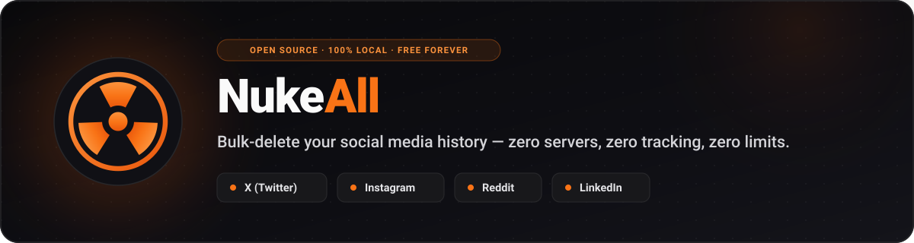

<div align="center">

<a href="https://nukeall.app/">
  
</a>

<br />
<br />

[](LICENSE)
[](https://nukeall.app/)
[](PRIVACY.md)
[](https://github.com/nukeall-app/nukeall/releases/latest)
[](https://buymeacoffee.com/inf0s33k)

<p>
  <a href="https://github.com/nukeall-app/nukeall/releases/latest"><strong>⬇️ Download Latest Release</strong></a>
  &nbsp;·&nbsp;
  <a href="https://nukeall.app/"><strong>Website</strong></a>
  &nbsp;·&nbsp;
  <a href="https://nukeall.app/install/"><strong>Install Guide</strong></a>
  &nbsp;·&nbsp;
  <a href="README.tr.md"><strong>🇹🇷 Türkçe</strong></a>
  &nbsp;·&nbsp;
  <a href="PRIVACY.md"><strong>Privacy</strong></a>
  &nbsp;·&nbsp;
  <a href="https://buymeacoffee.com/inf0s33k"><strong>☕ Buy Me a Coffee</strong></a>
</p>

<p>
  NukeAll bulk-deletes <strong>your own</strong> old posts, replies, comments, likes, reposts, bookmarks and sent Direct messages directly inside your browser — with zero servers, zero passwords and zero paywalls.
</p>

</div>

> [!TIP]
> **100% Private & Local by Design:** NukeAll runs directly inside your signed-in browser tab. No servers receive your data, no passwords or 2FA codes are ever requested, and zero analytics or tracking live inside the extension.

---

## 🚀 Supported Platforms

| Platform | What You Can Clean | Extra Capabilities |
| :--- | :--- | :--- |
| **X (Twitter)** | Tweets, replies, likes, reposts & bookmarks | Auto-clean recent history or import your official X data download to wipe posts from years ago |
| **Instagram** | Comments, likes, posts & sent Direct messages (`unsend`) | Removes only **your own** sent messages in Direct chats + imports official Instagram data downloads cleanly |
| **Reddit** | Comments & text posts | Overwrites each comment or post **0–3 times** with random or custom text before deleting + archive import |
| **LinkedIn** | Posts, comments & likes | Pick exact calendar dates or one-click age presets (`> 30d`, `> 6m`, `> 1y`) + official archive import |

---

## ✨ Why NukeAll?

<table>
  <tr>
    <td width="50%" valign="top">
      <strong>💸 Completely Free &amp; Unlimited</strong><br />
      No 30-day limits, no daily paywalls, no credits and no paid tiers. Delete 50 posts or 500,000.
    </td>
    <td width="50%" valign="top">
      <strong>🤬 Offline Profanity Filter</strong><br />
      Automatically highlight posts containing English or Turkish profanity (plus your own custom keywords) right inside your browser before deleting.
    </td>
  </tr>
  <tr>
    <td width="50%" valign="top">
      <strong>🛡️ Review Screen &amp; Protections</strong><br />
      Search, filter and check or uncheck items before anything is touched. Automatically protect pinned posts, popular posts and keep tags.
    </td>
    <td width="50%" valign="top">
      <strong>💾 Personal Backups &amp; Summary</strong><br />
      Optionally save a readable copy of your history (including a single-file offline web page you can search anytime) and view a post-cleanup summary.
    </td>
  </tr>
  <tr>
    <td width="50%" valign="top">
      <strong>⏱️ Account-Safe Pacing</strong><br />
      Randomized delays, automatic cooldowns when a platform asks to slow down, daily safety caps and automatic resume if interrupted.
    </td>
    <td width="50%" valign="top">
      <strong>🌍 English &amp; Turkish + Themes</strong><br />
      Full bilingual interface (EN / TR) with sleek Dark and Light themes built directly into the extension panel.
    </td>
  </tr>
</table>

---

## ⚡ How It Works

| 1. Install | 2. Scan & Review | 3. Clean Safely |
| :--- | :--- | :--- |
| Download NukeAll for Chrome or Firefox and open X, Instagram, Reddit or LinkedIn while already signed in. | Pick one content type, filter by date or profanity/keywords, and uncheck anything you want to keep. | Press clean and watch NukeAll work through your list at a gentle, account-safe pace — with an optional local backup. |

---

## 📦 Download & Install

Grab the latest builds directly from **[GitHub Releases](https://github.com/nukeall-app/nukeall/releases/latest)** under **Assets** (verified with `SHA256SUMS.txt` checksums). Need screenshots or extra tips? See the **[step-by-step install guide](https://nukeall.app/install/)**.

<table>
  <tr>
    <td width="50%" valign="top">
      <strong>🌐 Chrome / Edge / Brave</strong>
      <ol>
        <li>Download <code>nukeall-chrome.zip</code> from GitHub Releases and unzip it into a folder.</li>
        <li>Open <code>chrome://extensions</code> (or <code>edge://extensions</code> / <code>brave://extensions</code>).</li>
        <li>Enable <strong>Developer mode</strong> in the top-right corner.</li>
        <li>Click <strong>Load unpacked</strong> and select the extracted folder.</li>
      </ol>
    </td>
    <td width="50%" valign="top">
      <strong>🦊 Firefox</strong>
      <ol>
        <li><em>Firefox Add-ons store listing is not live yet.</em></li>
        <li>Download <code>nukeall-firefox.zip</code> from GitHub Releases.</li>
        <li>Open <code>about:debugging#/runtime/this-firefox</code> in the address bar.</li>
        <li>Click <strong>Load Temporary Add-on…</strong> and pick the downloaded file.</li>
      </ol>
    </td>
  </tr>
</table>

---

## 🔒 Privacy Guarantee

- ✅ **Zero credentials requested:** Never asks for your password, 2FA code, or API keys — works directly inside your existing signed-in browser tab.
- ✅ **Strict domain lock:** Browser permissions and Content Security Policy lock network access strictly to your chosen social platforms (`x.com`, `twitter.com`, `instagram.com`, `reddit.com`, `linkedin.com`).
- ✅ **Zero telemetry or external servers:** Automatically verified on every build via `npm run check:network`.
- ✅ **Verified open-source licenses:** Every dependency is audited in CI against `GPL-3.0-or-later` via `npm run check:licenses`.

---

<details>
<summary><strong>🛠️ Build from source (for developers)</strong></summary>

```bash
npm install
npm run check:licenses
npm test
npm run typecheck
npm run build
npm run lint:firefox -w apps/extension
npm run check:network
npm run check:seo
npm run package:release
```

</details>

---

## ☕ Support Independent Development

Other history-cleaning tools charge **$8–$24 per month** just to delete your own old posts. **NukeAll is 100% free, unlimited, ad-free and open source — maintained by a single independent developer.**

Every coffee helps cover the domain costs (`nukeall.app`), fix things quickly whenever X, Instagram, Reddit or LinkedIn change their layouts, and build support for new platforms like Bluesky and Threads. If NukeAll saved your time or cleaned years of history, consider supporting its upkeep:

<div align="center">
  <a href="https://buymeacoffee.com/inf0s33k">
    
  </a>
</div>

---

## 📜 Governance & Legal

- **Contributors:** Pull Request authors accept [CLA.md](CLA.md) ([`cla-signatures.json`](cla-signatures.json)).
- **Trademark:** Brand names and marks are governed by [TRADEMARK.md](TRADEMARK.md).
- **License:** [GPL-3.0-or-later](LICENSE).

> [!WARNING]
> **Disclaimer:** Social platforms discourage rapid automation in their Terms of Service. Keep the default **Safe** speed and daily safety limit enabled. Use at your own risk. NukeAll is an independent open-source project and is not affiliated with X Corp, Meta, Reddit or LinkedIn.

---

<div align="center">
  
  <br />
  <sub>Built with privacy first — clean your past, keep your control.</sub>
</div>
