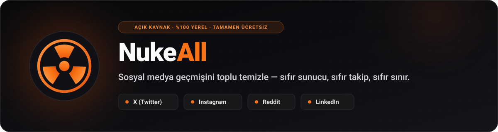

<div align="center">

<a href="https://nukeall.app/tr/">
  
</a>

<br />
<br />

[](LICENSE)
[](https://nukeall.app/tr/)
[](PRIVACY.md)
[](https://github.com/nukeall-app/nukeall/releases/latest)

<p>
  <a href="https://github.com/nukeall-app/nukeall/releases/latest"><strong>⬇️ Son Sürümü İndir</strong></a>
  &nbsp;·&nbsp;
  <a href="https://nukeall.app/tr/"><strong>Web Sitesi</strong></a>
  &nbsp;·&nbsp;
  <a href="https://nukeall.app/tr/kurulum/"><strong>Kurulum Rehberi</strong></a>
  &nbsp;·&nbsp;
  <a href="README.md"><strong>🇬🇧 English</strong></a>
  &nbsp;·&nbsp;
  <a href="PRIVACY.md"><strong>Gizlilik</strong></a>
  &nbsp;·&nbsp;
  <a href="https://nukeall.app/tr/destek/"><strong>Destek Ol</strong></a>
</p>

<p>
  NukeAll; <strong>yalnızca kendi</strong> gönderi, yanıt, yorum, beğeni, repost, yer imi ve giden sohbet (DM) mesajlarını doğrudan tarayıcının içinde toplu olarak siler — sunucu yok, şifre istemez ve ücretli sınır yok.
</p>

</div>

> [!TIP]
> **Baştan Sona %100 Yerel ve Özel:** NukeAll yalnızca açık olan tarayıcı sekmenin içinde çalışır. Hiçbir sunucuya veri göndermez, şifre veya doğrulama kodu istemez, içinde tek satır takip kodu barındırmaz.

---

## 🚀 Desteklenen Platformlar

| Platform | Neleri Temizleyebilirsin | Ek Özellikler |
| :--- | :--- | :--- |
| **X (Twitter)** | Tweet, yanıt, beğeni, repost ve yer imleri | Güncel geçmişi otomatik temizler veya yıllar öncesindeki paylaşımlar için resmi X veri arşivini içe aktarır |
| **Instagram** | Yorum, beğeni, gönderi ve giden DM mesajları (`unsend`) | Sohbetlerde **yalnızca senin gönderdiğin** mesajları geri alır ve resmi Instagram veri indirmesini sorunsuz işler |
| **Reddit** | Yorum ve metin gönderileri | Silmeden önce eski yazıların üzerine **0–3 tur** rastgele veya özel metin yazar + resmi Reddit arşivi yükleme |
| **LinkedIn** | Gönderi, yorum ve beğeniler | Takvimden kesin tarih seç veya tek tıkla yaş filtresi (`30 gün+`, `6 ay+`, `1 yıl+`) + LinkedIn arşivi desteği |

---

## ✨ Neden NukeAll?

<table>
  <tr>
    <td width="50%" valign="top">
      <strong>💸 Tamamen Ücretsiz ve Sınırsız</strong><br />
      30 gün sınırı, günlük kota, kredi veya ücretli abonelik yok. İster 50 ister 500.000 içerik temizle.
    </td>
    <td width="50%" valign="top">
      <strong>🤬 Çevrimdışı Küfür Filtresi</strong><br />
      Silmeden önce İngilizce ve Türkçe küfür kelimelerini (ve kendi eklediğin kelimeleri) tarayıcının içinde otomatik işaretler.
    </td>
  </tr>
  <tr>
    <td width="50%" valign="top">
      <strong>🛡️ Onay Ekranı ve Korumalar</strong><br />
      Sen onay vermeden hiçbir şey silinmez. Sabitlenen paylaşımlar, çok beğeni alan içerikler ve koruma kelimeleri otomatik korunur.
    </td>
    <td width="50%" valign="top">
      <strong>💾 Kişisel Yedek ve Özet</strong><br />
      İstersen silmeden önce bilgisayarında aranabilir kişisel bir yedek (tek dosyalık çevrimdışı sayfa dahil) ve temizlik özeti saklayabilirsin.
    </td>
  </tr>
  <tr>
    <td width="50%" valign="top">
      <strong>⏱️ Hesap Dostu Hız</strong><br />
      İnsansı gecikmeler, platform yavaşlamanı istediğinde otomatik bekleme, günlük güvenli limit ve kesinti halinde kaldığı yerden devam.
    </td>
    <td width="50%" valign="top">
      <strong>🌍 Türkçe / İngilizce ve Temalar</strong><br />
      Tam Türkçe ve İngilizce arayüz desteği ile göz yormayan karanlık ve aydınlık temalar.
    </td>
  </tr>
</table>

---

## ⚡ Nasıl Çalışır?

| 1. Kur | 2. Tara ve İncele | 3. Güvenle Temizle |
| :--- | :--- | :--- |
| Chrome veya Firefox sürümünü indir ve giriş yaptığın X, Instagram, Reddit ya da LinkedIn sekmesini aç. | Tek bir içerik türü seç; tarih, kelime veya küfür filtresiyle listeyi daralt ve saklamak istediklerini işaretten çıkar. | Başlat'a bas; NukeAll belirlediğin güvenli hızda temizliği yaparken istersen önce bilgisayarında yedek oluştursun. |

---

## 📦 İndirme ve Kurulum

En güncel paketler doğrulama kodlarıyla (`SHA256SUMS.txt`) birlikte doğrudan **[GitHub Releases](https://github.com/nukeall-app/nukeall/releases/latest)** sayfasındaki **Assets** bölümünde paylaşılır. Görsellerle adım adım anlatım için **[kurulum rehberine](https://nukeall.app/tr/kurulum/)** göz atabilirsin.

<table>
  <tr>
    <td width="50%" valign="top">
      <strong>🌐 Chrome / Edge / Brave</strong>
      <ol>
        <li>GitHub Releases üzerinden <code>nukeall-chrome.zip</code> dosyasını indir ve bir klasöre çıkar.</li>
        <li>Tarayıcıda <code>chrome://extensions</code> (veya <code>edge://extensions</code> / <code>brave://extensions</code>) adresini aç.</li>
        <li>Sağ üstten <strong>Geliştirici modu</strong>nu aktif et.</li>
        <li><strong>Paketlenmemiş öğe yükle</strong> butonuna basıp çıkardığın klasörü seç.</li>
      </ol>
    </td>
    <td width="50%" valign="top">
      <strong>🦊 Firefox</strong>
      <ol>
        <li><em>Eklenti henüz Firefox Add-ons mağazasında yayında değil.</em></li>
        <li>GitHub Releases üzerinden <code>nukeall-firefox.zip</code> dosyasını indir.</li>
        <li>Adres çubuğuna <code>about:debugging#/runtime/this-firefox</code> yazıp aç.</li>
        <li><strong>Geçici Eklenti Yükle…</strong> butonuna tıklayıp indirdiğin dosyayı seç.</li>
      </ol>
    </td>
  </tr>
</table>

---

## 🔒 Gizlilik Garantisi

- ✅ **Bilgilerin seninle kalır:** Şifre, iki adımlı doğrulama kodu veya API anahtarı asla istenmez — zaten giriş yaptığın mevcut tarayıcı sekmesinde çalışır.
- ✅ **Sıkı alan adı kilidi:** Tarayıcı güvenlik izinleri ağ erişimini yalnızca seçtiğin platformlarla (`x.com`, `twitter.com`, `instagram.com`, `reddit.com`, `linkedin.com`) sınırlar.
- ✅ **Sıfır telemetri ve sıfır sunucu:** Eklenti içinde hiçbir analiz veya dış sunucu bağlantısı yoktur; her derlemede otomatik `npm run check:network` testiyle doğrulanır.
- ✅ **Denetlenmiş açık kaynak lisansları:** Tüm bağımlılıklar CI ortamında `npm run check:licenses` ile `GPL-3.0-or-later` uyumluluğuna göre kontrol edilir.

---

<details>
<summary><strong>🛠️ Kaynak koddan derleme (geliştiriciler için)</strong></summary>

```bash
npm install
npm run check:licenses
npm test
npm run typecheck
npm run build
npm run lint:firefox -w apps/extension
npm run check:network
npm run check:seo
npm run package:release
```

</details>

---

## 📜 Katkı ve Marka Yönetişimi

- **Katkıcı Sözleşmesi:** Pull Request açan katkıcılar [CLA.md](CLA.md) sözleşmesini onaylar ([`cla-signatures.json`](cla-signatures.json)).
- **Marka Hakları:** NukeAll adı ve logo kullanımı [TRADEMARK.md](TRADEMARK.md) dosyasında tanımlıdır.
- **Lisans:** [GPL-3.0-or-later](LICENSE).

> [!WARNING]
> **Sorumluluk Reddi:** Sosyal platformlar kullanım koşullarında hızlı otomasyonu kısıtlar. Varsayılan **Güvenli** hızı ve günlük güvenli limiti açık tutun. Kullanım kendi sorumluluğunuzdadır. NukeAll bağımsız bir açık kaynak projesidir; X Corp, Meta, Reddit veya LinkedIn ile resmi bir bağı yoktur.

---

<div align="center">
  
  <br />
  <sub>Önce gizlilik ilkesiyle geliştirildi — geçmişini temizle, kontrolünü koru.</sub>
</div>
